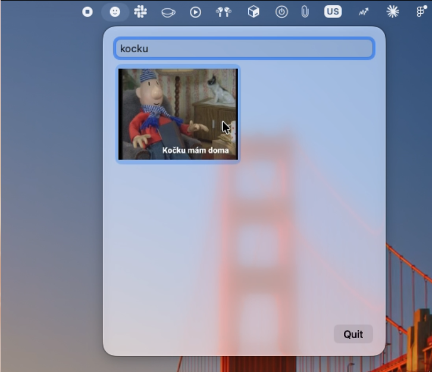
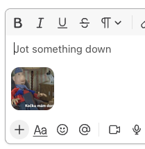

# PatAMat Keyboard

A macOS menu bar app for finding a reaction image by keyword and copying it to the clipboard in one click. Paste it straight into Slack, Messages, etc.


## How it works

| 1. Click the menu bar icon | 2. Type to filter | 3. Click an image, paste anywhere |
| --- | --- | --- |
|  |  |  |

## Build

Requires Xcode. No other dependencies. The app runs on macOS 14 (Sonoma) and newer.

The app has no Dock icon and no window: after launch, look for the smiley icon in the menu bar. Quit it from the popup (Quit button or ⌘Q while the popup is open).

### Dev build

Open the project in Xcode and press ⌘R:

```
open PatAMatKeyboard/PatAMatKeyboard.xcodeproj
```

Or from the terminal:

```
xcodebuild -project PatAMatKeyboard/PatAMatKeyboard.xcodeproj -scheme PatAMatKeyboard -configuration Debug -derivedDataPath build build
open build/Build/Products/Debug/PatAMatKeyboard.app
```

The Debug build checks the search rules on launch with `assert`s and crashes right away if one fails. Quit the installed app first, or you'll have two icons in the menu bar.

### Prod build and install

```
xcodebuild -project PatAMatKeyboard/PatAMatKeyboard.xcodeproj -scheme PatAMatKeyboard -configuration Release -derivedDataPath build clean build
pkill -x PatAMatKeyboard
rm -rf /Applications/PatAMatKeyboard.app
ditto build/Build/Products/Release/PatAMatKeyboard.app /Applications/PatAMatKeyboard.app
open /Applications/PatAMatKeyboard.app
```

Use `clean`: an incremental build can keep images you deleted from `Images/` in the app bundle. `pkill` doesn't stop a build running from Xcode: stop it there with ⌘. first. Otherwise `open` just brings that running copy forward instead of starting the installed app (they share a bundle ID).

To start it at login, add `/Applications/PatAMatKeyboard.app` in System Settings → General → Login Items (once; reinstalling to the same path should keep it, re-add it if it disappears).

Images are bundled into the app, so after adding, renaming or deleting images, run the prod build and install again.

### Share as a DMG

Build the Release app first (see above), then pack it into a DMG with the usual "drag to Applications" window:

```
rm -rf build/dmg && mkdir -p build/dmg
ditto build/Build/Products/Release/PatAMatKeyboard.app build/dmg/PatAMatKeyboard.app
ln -s /Applications build/dmg/Applications
hdiutil create -volname PatAMatKeyboard -srcfolder build/dmg -ov -format UDZO build/PatAMatKeyboard.dmg
```

Send `build/PatAMatKeyboard.dmg` to whoever wants it.

The app is not signed with a paid Apple Developer ID, so macOS blocks it on first launch. Send these steps along with the DMG:

1. Open the DMG and drag PatAMatKeyboard to Applications.
2. Open PatAMatKeyboard from Applications. macOS says it can't be verified: click **Done**.
3. Open System Settings → Privacy & Security, scroll down, click **Open Anyway** next to PatAMatKeyboard and confirm.
4. Look for the smiley icon in the menu bar.

If macOS says the app "is damaged and can't be opened", run this once in Terminal, then open the app again:

```
xattr -cr /Applications/PatAMatKeyboard.app
```

## Usage

Click the icon in the menu bar, type a few words, click an image. The image is now on your clipboard.

Search matches words from the file name, in any order and as partial words. Diacritics don't matter: `kdyz` and `když` find the same image.

## Adding your own images

Images are bundled in `PatAMatKeyboard/PatAMatKeyboard/Images/`. The file name is the search tag: lowercase, no diacritics, words separated by `-`, e.g. `this-is-fine.png`. PNG and JPG only.

You can name and drop the files there by hand, or let the import script name them from the text in the image:

```
swift scripts/import-memes.swift ~/Downloads/my-memes            # dry run: prints old -> new
swift scripts/import-memes.swift ~/Downloads/my-memes --apply    # moves the files into Images/new/ — check names, then move them up into Images/
```

The script uses macOS's built-in text recognition (Czech and English). You don't need to install anything besides Xcode. It:

- names each image by its text, e.g. `Když to bylo předpovězeno!` → `kdyz-to-bylo-predpovezeno.jpg`, capped at 60 characters
- drops known watermarks such as `made with mematic`. To strip more, add them to the `watermarks` list at the top of the script
- adds `-2`, `-3` when a name is already taken
- names images without text `meme`, `meme-2`, … so you can rename them by hand

Always check the dry run first: OCR sometimes misreads a word. Rebuild the app after adding images.
